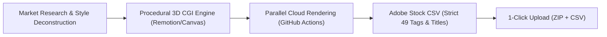

# Turnkey 4K 60fps Motion Graphics Pipeline for Adobe Stock

An automated, commercial-grade procedural CGI production and publishing pipeline for generating broadcast-quality (3840x2160 @ 60fps) loopable motion graphic videos, policy-compliant metadata, and automated parallel cloud rendering.

---

## 🏛️ System Architecture



---

## 🎨 11 Procedural CGI Archetypes (Seamless 10-Second Loops)

Every asset is mathematically tied to harmonic trigonometry ($\theta = \frac{2\pi \cdot \text{frame}}{600}$), guaranteeing that frame 0 and frame 600 match seamlessly with zero cut seams.

| Composition ID | Asset Name | Dimensions | Specs | Category |
| :--- | :--- | :--- | :--- | :--- |
| `liquid-chrome` | Liquid Chrome & Mercury Ripples | 3840x2160 | 60fps / 10s Loop | Backgrounds (3) |
| `iridescent-silk` | Fluid Iridescent Silk Waves | 3840x2160 | 60fps / 10s Loop | Backgrounds (3) |
| `obsidian-gold` | 3D Obsidian & Gold Low-Poly Facets | 3840x2160 | 60fps / 10s Loop | Backgrounds (3) |
| `cyber-grid` | Retro Cyber Perspective Grids | 3840x2160 | 60fps / 10s Loop | Technology (18) |
| `champagne-bokeh` | Volumetric Champagne Golden Bokeh | 3840x2160 | 60fps / 10s Loop | Backgrounds (3) |
| `dark-concentric` | Viscous Dark Concentric Ripples | 3840x2160 | 60fps / 10s Loop | Backgrounds (3) |
| `cosmic-nebula` | Deep Space Cosmic Nebulae | 3840x2160 | 60fps / 10s Loop | Backgrounds (3) |
| `bioluminescent` | Bioluminescent Deep Sea Plumes | 3840x2160 | 60fps / 10s Loop | Backgrounds (3) |
| `quantum-waveguide`| Coherent Quantum Waveguides | 3840x2160 | 60fps / 10s Loop | Technology (18) |
| `sacred-geometry` | Kinetic Sacred Geometry Mandalas | 3840x2160 | 60fps / 10s Loop | Backgrounds (3) |
| `paper-topography` | Minimalist Architectural Topography| 3840x2160 | 60fps / 10s Loop | Backgrounds (3) |

---

## 🛡️ Strict Adobe Stock Policy Compliance

* **Zero Living Beings**: No humans, faces, silhouettes, animals, or body parts.
* **Zero Financial Elements**: No cryptocurrencies, candlesticks, forex, or fiat symbols.
* **Zero Audio / Music**: Pure visual B-roll; no audio tracks, waveforms, or DJ graphics.
* **Zero Hardcoded Text**: Clean universal visuals without English titles or branding.
* **Title Length**: Strictly $\le 70$ characters (prevents truncation in Adobe search).
* **Tags**: Exactly **49 high-converting SEO tags** per video (no duplicate tags, sorted by relevance).

---

## 🚀 Quickstart & Local Development

### 1. Interactive Preview Studio
To preview all compositions live in your browser at 60fps with scrub controls:
```bash
npm start
```

### 2. Validate Compliance & Metadata
Run the automated compliance auditor to verify titles, tag counts, and policy checks:
```bash
npm run validate
```

### 3. Generate Adobe Stock Upload CSV
Compiles `adobe_stock_upload.csv` ready to drag and drop into the Adobe Stock Contributor Portal:
```bash
npm run metadata
```

### 4. Local Rendering (Optional)
Render a single video:
```bash
npm run render:single -- --id liquid-chrome
```
Render all 11 videos locally:
```bash
npm run render:all
```

---

## ☁️ Automated Cloud Rendering via GitHub Actions

You do not need an expensive GPU workstation to render 4K 60fps videos. The included GitHub Actions workflow parallelizes the rendering across **11 simultaneous cloud runners**.

### How to Run in GitHub Actions:
1. Push this repository to GitHub.
2. Go to the **Actions** tab in your GitHub repository.
3. Select the workflow **"Parallel 4K 60fps Cloud Rendering Pipeline"**.
4. Click **Run workflow**:
   - **Output Video Codec**: Choose `h264` (MP4) or `prores` (Apple ProRes 422 HQ).
   - **Constant Rate Factor**: Default `12` (broadcast master).
   - **Render Target**: Select `all` (11 parallel runners) or any single composition.
5. In ~5 to 10 minutes, download the bundled artifact:
   `Loopable_Abstract_Batch_01_4K_Videos_mp4.zip`

---

## 📤 1-Click Publishing to Adobe Stock

1. Extract the downloaded ZIP file containing the rendered 4K videos and `adobe_stock_upload.csv`.
2. Open the **[Adobe Stock Contributor Portal](https://contributor.stock.adobe.com/)**.
3. Upload your `.mp4` or `.mov` video files.
4. Click **"Upload CSV"** and select `adobe_stock_upload.csv`.
5. All titles, category IDs, and 49 search tags automatically populate for all 11 assets.
6. Click **Submit for Review**.
